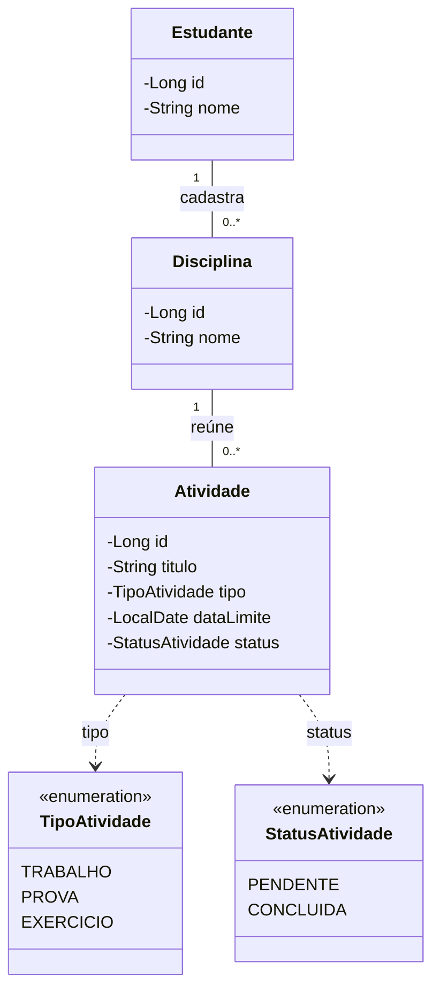

# API de Planejamento de Estudos

## Tema

Educação e Aprendizado.

## Integrantes

- Pedro Henrique Teixeira Barth
- Marcelo Vinícius Batista Candido
- João Vitor Goulart Viana

## Problema

Estudantes com várias disciplinas recebem prazos de trabalhos, provas e listas de exercícios em lugares diferentes. Quando essas informações ficam espalhadas, é difícil saber o que precisa ser feito primeiro e o que já foi concluído.

## Aplicação e domínio

A API permite que o estudante cadastre as disciplinas que cursa e registre as atividades de cada uma. Cada atividade tem um tipo, uma data-limite e um status. O estudante pode consultar as atividades pendentes de uma disciplina, ordenadas pelo prazo mais próximo.

| Entidade | Responsabilidade |
| --- | --- |
| `Estudante` | Identifica o estudante que organiza seu planejamento. |
| `Disciplina` | Representa uma disciplina na agenda de um estudante. |
| `Atividade` | Representa um trabalho, uma prova ou um exercício com prazo em uma disciplina. |

Um estudante pode ter zero ou mais disciplinas na sua agenda. Cada disciplina pertence a um estudante e pode ter zero ou mais atividades. Cada atividade pertence a uma única disciplina.

### Regras iniciais

- Toda disciplina deve estar vinculada a um estudante cadastrado.
- Toda atividade deve ter título, tipo, data-limite e uma disciplina cadastrada.
- Uma atividade começa com o status `PENDENTE` e pode ser marcada como `CONCLUIDA`.

### Exemplo de uso

Um estudante cadastra a disciplina Programação Web e adiciona o trabalho “Projeto final de API REST”, com prazo em 03/12/2026. Ao consultar as atividades pendentes da disciplina, ele encontra o trabalho na lista ordenada por data-limite. Depois da entrega, marca a atividade como concluída.

## Diagrama UML inicial



O lado marcado com `1` é obrigatório. Cada disciplina pertence a um estudante e cada atividade pertence a uma disciplina. `0..*` indica que o estudante pode começar sem disciplinas e a disciplina pode começar sem atividades.


## Tecnologias

- Java 21 e Maven
- Spring Boot 3.5.14 com Spring Web, Spring Data JPA e Jakarta Validation
- PostgreSQL 16 com migração do Flyway
- Docker Compose para subir o banco local

O **Controller** recebe as chamadas HTTP e valida o JSON. O **Service** aplica as regras, verifica vínculos e executa as operações em transações. O **Repository** consulta e grava os dados usando JPA. O Flyway cria as tabelas na primeira inicialização e o Hibernate valida o esquema.

## Como executar

É necessário ter o **JDK 21**, o **Maven 3.9+** e o **Docker com Compose**. Na pasta do projeto, execute:

```sh
docker compose up -d --wait
mvn spring-boot:run
```

A API fica disponível em `http://localhost:8080`. Para testar se está respondendo, abra `http://localhost:8080/estudantes`. Na primeira execução, a listagem começa vazia.

O Compose disponibiliza o PostgreSQL em `localhost:5433` e guarda os dados em um volume local. Se você já tem um PostgreSQL, crie um banco e um usuário com permissão para criar as tabelas e informe as variáveis abaixo antes de iniciar a aplicação.

| Variável | Padrão para desenvolvimento local |
| --- | --- |
| `DB_URL` | `jdbc:postgresql://localhost:5433/planejamento_estudos` |
| `DB_USER` | `estudos` |
| `DB_PASSWORD` | `estudos_local` |
| `PORT` | `8080` |

No PowerShell, por exemplo, use `$env:DB_URL = "jdbc:postgresql://localhost:5432/planejamento_estudos"` para apontar para um PostgreSQL na porta 5432.

## Rotas e DTOs

As mesmas cinco operações estão disponíveis em `/estudantes`, `/disciplinas` e `/atividades`. Envie corpos JSON com `Content-Type: application/json`.

| Método | Caminho | Operação | Sucesso |
| --- | --- | --- | --- |
| GET | `/{recurso}` | Lista registros em páginas | `200 OK` |
| GET | `/{recurso}/{id}` | Busca um registro | `200 OK` |
| POST | `/{recurso}` | Cria um registro | `201 Created` e cabeçalho `Location` |
| PUT | `/{recurso}/{id}` | Substitui os dados editáveis do registro | `200 OK` |
| DELETE | `/{recurso}/{id}` | Exclui o registro | `204 No Content` |

| Recurso | DTO de entrada no POST | DTO de entrada no PUT | DTO de saída |
| --- | --- | --- | --- |
| Estudante | `nome` | `nome` | `id`, `nome` |
| Disciplina | `nome`, `estudanteId` | `nome`, `estudanteId` | `id`, `nome`, `estudanteId` |
| Atividade | `titulo`, `tipo`, `dataLimite`, `disciplinaId` | Os mesmos campos do POST, mais `status` | `id`, `titulo`, `tipo`, `dataLimite`, `status`, `disciplinaId` |

Para testar no Postman, crie os registros abaixo na ordem indicada. Use o ID retornado pelo primeiro POST em `estudanteId` e o ID do segundo em `disciplinaId`.

| Requisição | Corpo JSON de exemplo |
| --- | --- |
| `POST /estudantes` | `{"nome":"Estudante de exemplo"}` |
| `POST /disciplinas` | `{"nome":"Programação Web","estudanteId":1}` |
| `POST /atividades` | `{"titulo":"Projeto final de API REST","tipo":"TRABALHO","dataLimite":"2026-12-03","disciplinaId":1}` |
| `PUT /atividades/1` | `{"titulo":"Projeto final de API REST","tipo":"TRABALHO","dataLimite":"2026-12-03","disciplinaId":1,"status":"CONCLUIDA"}` |

O ID é gerado pelo banco. O POST de atividade define o status inicial como `PENDENTE`. A API rejeita campos fora do DTO. O formato de data é `AAAA-MM-DD`.

## Paginação, filtros e ordenação

- `page` começa em 0 e `size` aceita de 1 a 100. Os padrões são `page=0` e `size=20`.
- `sort` aceita um campo e a direção `asc` ou `desc`, separados por vírgula. Na listagem de estudantes e disciplinas, são permitidos `id` e `nome`, com padrão `id,asc`. Na listagem de atividades, são permitidos `id`, `dataLimite` e `titulo`, com padrão `dataLimite,asc`. O ID desempata registros com o mesmo valor de ordenação.
- `GET /atividades` aceita os filtros opcionais `status` e `disciplinaId`. Enviar ambos aplica as duas condições.

Exemplo antes de marcar a atividade como concluída:

```http
GET /atividades?disciplinaId=1&status=PENDENTE&page=0&size=5&sort=dataLimite,asc
```

```json
{
  "content": [
    {
      "id": 1,
      "titulo": "Projeto final de API REST",
      "tipo": "TRABALHO",
      "dataLimite": "2026-12-03",
      "status": "PENDENTE",
      "disciplinaId": 1
    }
  ],
  "page": 0,
  "size": 5,
  "totalElements": 1,
  "totalPages": 1
}
```

## Validação e erros HTTP

Nomes devem ter de 1 a 120 caracteres e títulos de 1 a 160. Campos obrigatórios rejeitam valores ausentes ou em branco, e os IDs de vínculo devem ser positivos.

| Situação | Exemplo | Resposta |
| --- | --- | --- |
| Campo obrigatório ausente ou vazio | `POST /estudantes` com `{"nome":""}` | `400 Bad Request` |
| JSON malformado, data inválida ou valor fora da enumeração | `POST /atividades` com `"tipo":"OUTRO"` | `400 Bad Request` |
| Paginação ou ordenação inválida | `GET /atividades?size=0` | `400 Bad Request` |
| Registro ou vínculo inexistente | `GET /estudantes/999` ou disciplina vinculada a estudante inexistente | `404 Not Found` |
| Exclusão de registro com dependências | `DELETE /disciplinas/1` enquanto há atividades da disciplina | `409 Conflict` |
| Falha inesperada no servidor | Falha interna durante o processamento | `500 Internal Server Error` |

Exemplo de resposta para o nome vazio:

```json
{
  "type": "about:blank",
  "title": "Dados inválidos",
  "status": 400,
  "detail": "Corrija os campos indicados e envie a requisição novamente.",
  "instance": "/estudantes",
  "erros": [
    {"campo": "nome", "mensagem": "O nome é obrigatório."}
  ]
}
```

Para excluir todos os registros do exemplo, exclua primeiro a atividade, depois a disciplina e por último o estudante.

## Evidências da E2

O relatório registra as requisições HTTP que passaram, as respostas JSON de exemplo e o teste de persistência após reiniciar a API. [Evidências de execução](docs/evidencias-e2.md).
