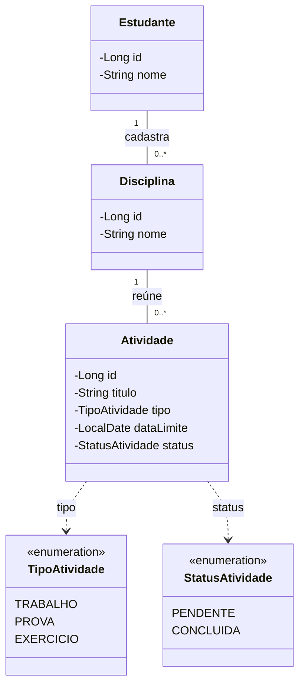

# API de Planejamento de Estudos

Projeto final de API REST da **Unisatc**, no tema **Educação e Aprendizado**.

## Projeto e aplicação

Estudantes com várias disciplinas recebem informações sobre trabalhos, provas e exercícios em lugares diferentes. Isso dificulta saber quais atividades estão pendentes e quais prazos precisam de atenção primeiro.

A API permite cadastrar estudantes, organizar as disciplinas de cada um e registrar atividades com tipo, data-limite e status. O estudante pode consultar as atividades pendentes de uma disciplina, em ordem de prazo, e marcar uma atividade como concluída.

## Integrantes e papéis

| Integrante | Responsabilidade |
| --- | --- |
| Pedro Henrique Teixeira Barth | Desenvolvimento da API REST, incluindo os CRUDs, os DTOs e as camadas controller, service e repository. |
| Marcelo Vinícius Batista Candido | Testes da API e registro das evidências de paginação, filtros, ordenação e erros HTTP. |
| João Vitor Goulart Viana | Banco de dados e execução local, incluindo a configuração do PostgreSQL no Docker Compose e a verificação dos relacionamentos. |

## Tecnologias

- Java 21 e Maven Wrapper
- Spring Boot, Spring Web, Spring Data JPA e Jakarta Validation
- PostgreSQL 16 e Docker Compose

A camada `controller` recebe as requisições HTTP e valida os DTOs de entrada. A camada `service` aplica as regras, verifica os vínculos e transforma os resultados em DTOs de saída. A camada `repository` consulta e grava os dados no PostgreSQL por meio do Spring Data JPA.

## Entidades e relacionamentos

| Entidade | Descrição |
| --- | --- |
| `Estudante` | Identifica quem organiza o planejamento de estudos. |
| `Disciplina` | Representa uma matéria da agenda de um estudante. |
| `Atividade` | Representa um trabalho, uma prova ou um exercício vinculados a uma disciplina, com título, prazo e status. |

Um estudante pode ter zero ou mais disciplinas. Cada disciplina pertence a um único estudante e pode ter zero ou mais atividades. Cada atividade pertence a uma única disciplina.

### Diagrama UML



## Como executar localmente

### Pré-requisitos

- JDK 21
- Docker com Docker Compose

Abra o Docker Desktop e, no PowerShell, execute os comandos abaixo na raiz do projeto:

```powershell
docker compose up -d --wait
.\mvnw.cmd spring-boot:run
```

A API ficará disponível em `http://localhost:8081`. Em outro PowerShell, faça uma primeira consulta:

```powershell
curl.exe -i http://localhost:8081/estudantes
```

A API deve retornar `200 OK`. Em um banco novo, a lista `content` estará vazia.

### Banco de dados e variáveis de ambiente

O Docker Compose executa o PostgreSQL na porta `5433` do computador. O banco se chama `planejamento_estudos`. O Hibernate cria ou atualiza as tabelas ao iniciar a aplicação no ambiente local. O volume do Docker mantém os dados entre reinicializações do contêiner.

| Variável | Finalidade | Valor padrão local |
| --- | --- | --- |
| `DB_URL` | URL JDBC do PostgreSQL | `jdbc:postgresql://localhost:5433/planejamento_estudos` |
| `DB_USER` | Usuário do PostgreSQL | `estudos` |
| `DB_PASSWORD` | Senha do PostgreSQL local | `estudos_local` |

Esses valores correspondem ao banco configurado no `compose.yaml`. Para usar outra instância do PostgreSQL, defina as variáveis no terminal antes de iniciar a aplicação.

## Endpoints

As operações abaixo estão disponíveis para `estudantes`, `disciplinas` e `atividades`. Substitua `{recurso}` por um desses nomes.

| Método | Rota | Operação | Resposta de sucesso |
| --- | --- | --- | --- |
| `GET` | `/{recurso}` | Listar registros com paginação | `200 OK` |
| `GET` | `/{recurso}/{id}` | Buscar por ID | `200 OK` |
| `POST` | `/{recurso}` | Cadastrar | `201 Created` |
| `PUT` | `/{recurso}/{id}` | Atualizar | `200 OK` |
| `DELETE` | `/{recurso}/{id}` | Excluir | `204 No Content` |

Envie `Content-Type: application/json` nas requisições `POST` e `PUT`.

### DTOs de entrada e saída

| Recurso | DTO de entrada no POST | DTO de entrada no PUT | DTO de saída |
| --- | --- | --- | --- |
| Estudante | `EstudanteRequest` com `nome` | `EstudanteRequest` com `nome` | `EstudanteResponse` com `id` e `nome` |
| Disciplina | `DisciplinaRequest` com `nome` e `estudanteId` | `DisciplinaRequest` com `nome` e `estudanteId` | `DisciplinaResponse` com `id`, `nome` e `estudanteId` |
| Atividade | `AtividadeRequest` com `titulo`, `tipo`, `dataLimite` e `disciplinaId` | `AtividadeUpdateRequest` com `titulo`, `tipo`, `dataLimite`, `status` e `disciplinaId` | `AtividadeResponse` com `id`, `titulo`, `tipo`, `dataLimite`, `status` e `disciplinaId` |

### Exemplo de cadastro e atualização

Execute os cadastros na ordem abaixo. Use os IDs retornados pela API no lugar dos IDs ilustrativos.

| Requisição | Corpo JSON |
| --- | --- |
| `POST /estudantes` | `{"nome":"Estudante de teste"}` |
| `POST /disciplinas` | `{"nome":"Banco de Dados","estudanteId":1}` |
| `POST /atividades` | `{"titulo":"Prova final","tipo":"PROVA","dataLimite":"2026-12-02","disciplinaId":1}` |
| `PUT /atividades/1` | `{"titulo":"Prova final","tipo":"PROVA","dataLimite":"2026-12-02","status":"CONCLUIDA","disciplinaId":1}` |

Toda atividade é cadastrada com o status `PENDENTE`. Para excluir registros com vínculos, siga a ordem atividade, disciplina e estudante.

## Paginação, filtros e ordenação

| Parâmetro | Comportamento |
| --- | --- |
| `page` | Número da página, começando em `0`. O padrão é `0`. |
| `size` | Quantidade de registros por página. Aceita valores de `1` a `100`. O padrão é `10`. |
| `sort` | Use `nome,asc` ou `nome,desc` em estudantes e disciplinas. Use `dataLimite,asc` ou `dataLimite,desc` em atividades. A ordem padrão é crescente. |
| `status` | Filtro opcional de atividades. Aceita `PENDENTE` ou `CONCLUIDA`. |
| `disciplinaId` | Filtro opcional de atividades pelo ID da disciplina. |

Os filtros `status` e `disciplinaId` podem ser usados juntos. Quando dois itens têm o mesmo valor no campo de ordenação, o `id` desempata.

**Exemplo de requisição**

```http
GET /atividades?status=PENDENTE&disciplinaId=1&page=0&size=1&sort=dataLimite,asc
```

**Resposta observada no teste com `200 OK`**

```json
{
  "content": [
    {
      "id": 4,
      "titulo": "Revisao de SQL",
      "tipo": "EXERCICIO",
      "dataLimite": "2026-11-30",
      "status": "PENDENTE",
      "disciplinaId": 1
    }
  ],
  "page": 0,
  "size": 1,
  "totalElements": 2,
  "totalPages": 2
}
```

Neste teste, `totalElements` indica que duas atividades atendem ao filtro. Como `size=1`, a segunda atividade aparece na página `1`.

## Validação e erros HTTP

- O nome do estudante e o nome da disciplina são obrigatórios e aceitam até 120 caracteres.
- O título da atividade é obrigatório e aceita até 160 caracteres.
- Os IDs informados para criar ou atualizar vínculos devem ser positivos e apontar para registros existentes.
- A atividade exige `tipo` e `dataLimite`. Use `TRABALHO`, `PROVA` ou `EXERCICIO` como tipo e envie a data no formato `AAAA-MM-DD`.
- No `PUT` de atividade, informe `PENDENTE` ou `CONCLUIDA` no campo `status`.

| Código | Exemplo |
| --- | --- |
| `400 Bad Request` | Cadastrar um estudante com `nome` vazio, enviar JSON inválido ou consultar uma página com `size=0`. |
| `404 Not Found` | Buscar um estudante inexistente ou cadastrar uma disciplina com um `estudanteId` que não existe. |
| `409 Conflict` | Tentar excluir uma disciplina que ainda tem atividades vinculadas. |

Os erros tratados retornam `application/problem+json`. O campo `detail` explica o problema. Em erros de validação do DTO, a lista `campos` identifica os campos inválidos.

**Exemplo de resposta ao enviar `{"nome":""}` em `POST /estudantes`**

```json
{
  "detail": "Corrija os campos indicados.",
  "status": 400,
  "title": "Bad Request",
  "campos": [
    {
      "campo": "nome",
      "mensagem": "O nome é obrigatório."
    }
  ]
}
```

**Exemplo de resposta ao tentar excluir uma disciplina com atividades**

```json
{
  "detail": "A operação viola uma restrição do banco. Verifique os registros vinculados.",
  "status": 409,
  "title": "Conflict"
}
```

## Evidências da E2

Os testes locais cobriram os três CRUDs, a persistência no PostgreSQL, os relacionamentos, a paginação, os filtros, a ordenação e as respostas de erro. [Consultar as evidências da E2](docs/evidencias-e2.md).

## Carta-desafio

**Pendente de recebimento do enunciado.** Esta seção será atualizada na E3.

| Item | Situação |
| --- | --- |
| História de usuário | Aguardando a carta-desafio. |
| Critérios de aceite | A definir a partir do enunciado. |
| Implementação | Pendente. A funcionalidade será integrada à API existente. |
| Endpoints novos ou alterados | A definir após a análise da carta. |
| Issue e pull request | A registrar na E3 para acompanhar a implementação e a integração. |