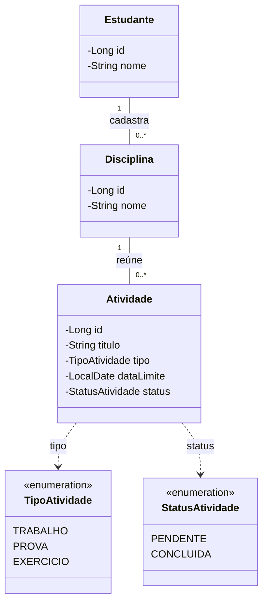

# API de Planejamento de Estudos

## Tema

Educação e Aprendizado.

## Integrantes

- Pedro Henrique Teixeira Barth
- Marcelo Vinícius Batista Candido
- João Vitor Goulart Viana

## Problema

Estudantes com várias disciplinas recebem prazos de trabalhos, provas e listas de exercícios em lugares diferentes. Quando essas informações ficam espalhadas, é difícil saber o que precisa ser feito primeiro e o que já foi concluído.

## Aplicação e domínio

A API permite que o estudante cadastre as disciplinas que cursa e registre as atividades de cada uma. Cada atividade tem um tipo, uma data-limite e um status. O estudante pode consultar as atividades pendentes de uma disciplina, ordenadas pelo prazo mais próximo.

| Entidade | Responsabilidade |
| --- | --- |
| `Estudante` | Identifica o estudante que organiza seu planejamento. |
| `Disciplina` | Representa uma disciplina na agenda de um estudante. |
| `Atividade` | Representa um trabalho, uma prova ou um exercício com prazo em uma disciplina. |

Um estudante pode ter zero ou mais disciplinas na sua agenda. Cada disciplina pertence a um estudante e pode ter zero ou mais atividades. Cada atividade pertence a uma única disciplina.

### Regras iniciais

- Toda disciplina deve estar vinculada a um estudante cadastrado.
- Toda atividade deve ter título, tipo, data-limite e uma disciplina cadastrada.
- Uma atividade começa com o status `PENDENTE` e pode ser marcada como `CONCLUIDA`.

### Exemplo de uso

Um estudante cadastra a disciplina Programação Web e adiciona o trabalho “Projeto final de API REST”, com prazo em 03/12/2026. Ao consultar as atividades pendentes da disciplina, ele encontra o trabalho na lista ordenada por data-limite. Depois da entrega, marca a atividade como concluída.

## Diagrama UML inicial

O lado marcado com `1` é obrigatório. Cada disciplina pertence a um estudante e cada atividade pertence a uma disciplina. `0..*` indica que o estudante pode começar sem disciplinas e a disciplina pode começar sem atividades.
